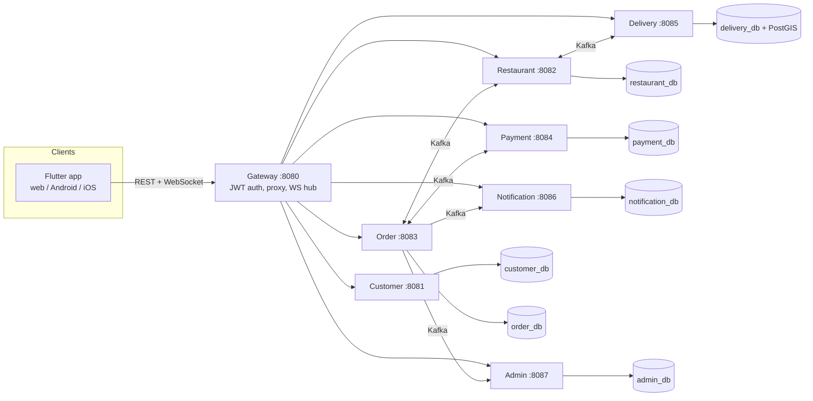

# Architecture

A food delivery platform: Go microservices,
Kafka, PostgreSQL/PostGIS, a Flutter client, all in Docker Compose. See
[../README.md](../README.md) for how to run it, [AUDIT.md](AUDIT.md) for
known gaps and the improvement plan, and [TESTING.md](TESTING.md) for how
each part is tested.

## Services



Every service that changes state (restaurant, order, payment, delivery)
writes its domain change and an outbox row in one Postgres transaction; a
relay goroutine polls the outbox and publishes to Kafka (`pkg/outbox`). Every
consumer checks a `processed_events` table in the same transaction as its
side effects (`pkg/db.InsertIfNew`), so Kafka's at-least-once delivery can
never double-apply an event.

## Order lifecycle

```
CREATED → CONFIRMED → PREPARING → READY → OUT_FOR_DELIVERY → DELIVERED
   └──────────────────────┴────────────┴───────────┘
                     (or CANCELLED, from any non-terminal state)
```

`CONFIRMED` requires both `payments.completed` and
`restaurant.order-accepted` (`services/order/internal/domain.MaybeConfirm`),
and falls straight through to `PREPARING`. The full topic list and event
payloads live in `pkg/events/events.go` — the single source of truth every
service imports, instead of a separate contract document that could drift
from the code.

## Compensation (the saga)

- **Restaurant rejects** → `restaurant.order-rejected` → Order cancels →
  `orders.cancelled` → Payment refunds (if it had already charged) and
  Restaurant releases any reserved stock.
- **Payment fails** → `payments.failed` → Order cancels → `orders.cancelled`
  → Restaurant releases reserved stock.
- **No driver free** when a restaurant marks an order ready → Delivery
  queues it in `pending_assignments` and retries every 5s
  (`services/delivery/internal/sim.PendingAssignmentRetrier`) instead of
  dropping it.

## Security

Every service verifies the caller's JWT and enforces roles and ownership on
each route. The gateway checks too, as an early reject, and is the only
published port. Why services verify tokens themselves rather than trusting
a gateway header: [adr/0001](adr/0001-identity-propagation.md). The order
service prices orders from the restaurant's catalogue (called as the user),
and the restaurant re-validates items and prices on acceptance.

## Notable design choices

- **Nearest-driver assignment** uses PostGIS's `<->` KNN operator against a
  GiST index (`services/delivery/internal/store.FindNearestAvailableForUpdate`),
  with `FOR UPDATE SKIP LOCKED` so two orders never race for the same driver.
- **Driver location simulation** (`services/delivery/internal/sim.LocationSimulator`)
  moves an assigned driver toward its current target every 2s and publishes
  `delivery.location` directly (bypassing the outbox — this is ephemeral
  telemetry, not a durable domain fact). A real driver's GPS ping
  (`PATCH /drivers/{id}/location`) disables simulation for that delivery.
- **Surge pricing** is a pure function of open orders vs. an assumed free-driver
  count (`services/order/internal/domain.SurgeMultiplierFor`), applied to the
  delivery fee at order creation.
- **The Notification and Admin services** each use their own Kafka consumer
  group (`notification-service`, `admin-service`) so they see every event
  regardless of what other services consume, per Kafka's consumer-group
  semantics.
- **Idempotency keys**: payment charges are keyed by `orderId`, so a
  redelivered `orders.created` can never charge an order twice.
